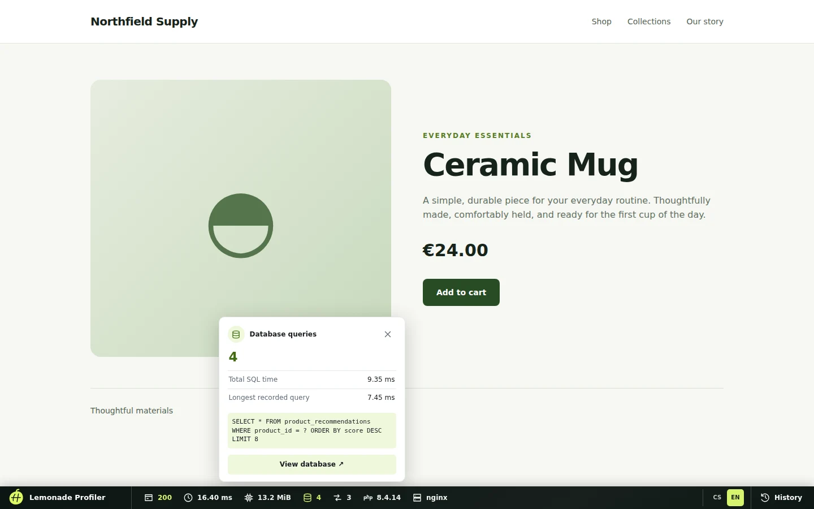
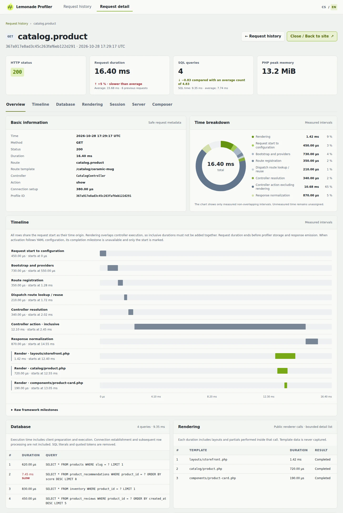
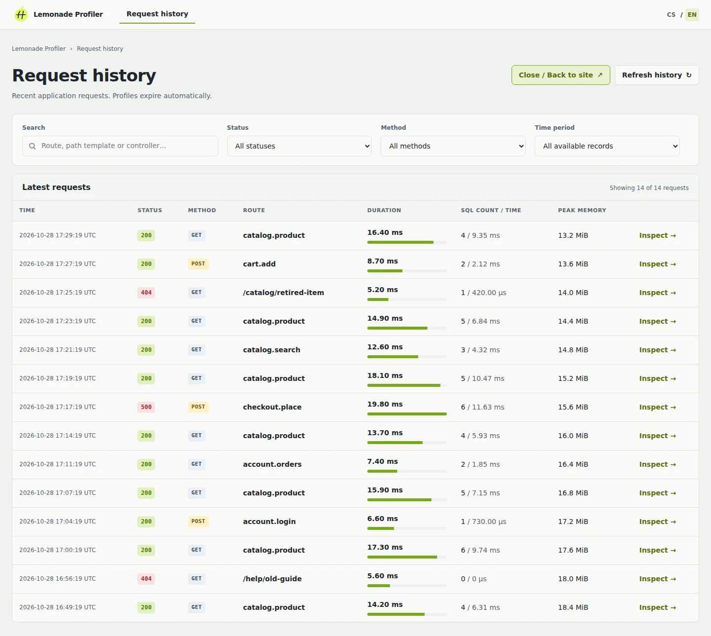

# Lemonade Profiler

[](https://github.com/johnnyxlemonade/profiler/actions/workflows/phpstan.yml)
[](https://github.com/johnnyxlemonade/profiler/actions/workflows/phpunit.yml)
[](https://github.com/johnnyxlemonade/profiler/actions/workflows/coding-standards.yml)

## Introduction

Lemonade Profiler adds request, SQL, and rendering diagnostics to Lemonade Framework applications. It provides an interactive toolbar, recent request history, and a detail page for each saved profile.

## Features

- Shadow DOM debug toolbar on eligible HTML responses, with light and dark appearance.
- HTTP timing, status, route, and peak PHP memory measurements.
- SQL totals and bounded, sanitized query details.
- Request timeline and view rendering measurements, with durations shown in milliseconds or microseconds.
- Duration and SQL comparisons with earlier requests to the same route and method when enough history is available.
- Searchable request history with status, method, and time filters.
- Session, Server/PHP, and Composer diagnostics.
- Czech and English interface, including a language switch.
- Fetch and XHR request monitoring in the toolbar for profiled same-origin responses.

## Screenshots

### Debug Toolbar



*Inspect current request metrics and SQL details without leaving the page.*

### Request Details



*Review timing, SQL, rendering, and comparison data for one request.*

### Request History



*Find recent requests with search and filters.*

## Requirements

- PHP 8.3, 8.4, or 8.5 (`>=8.3 <8.6`).
- `johnnyxlemonade/framework:dev-main`.

## Installation

Install the current public development version with Composer:

```bash
composer require johnnyxlemonade/profiler:dev-main
```

Add the provider after your existing providers in `app/Config/Providers.yaml`:

```yaml
module: providers
config:
  providers:
    - Lemonade\Profiler\ProfilerServiceProvider
```

The regular `require` dependency remains available after a production `composer install --no-dev`. If you instead install with `composer require --dev`, that deployment omits the package; remove its provider registration there as well.

## Usage

The toolbar appears on eligible HTML responses when the provider is registered and the profiler is enabled. Its HTTP panel also lists profiled same-origin Fetch and XHR responses made after the toolbar loads. Use the toolbar links or open `/_lemonade/profiler` for request history and `/_lemonade/profiler/request/{id}` for a saved request's details.

History supports search by route, path template, or controller, plus status, method, and time filters. Request details show measurements and, when at least five comparable earlier requests exist, duration and SQL comparisons. The toolbar and profiler pages support Czech and English; use their CS/EN switch or `?lang=cs` / `?lang=en` on profiler pages.

## Configuration

Registering the provider enables profiling by default. `ProfilerConfig::enabled()` controls activation independently of `APP_ENV` and `APP_DEBUG`. To disable it, bind a `ProfilerConfig` with `enabled: false` in the root container before the first request; see [activation and access control](docs/activation.md).

By default, storage retains up to 100 profiles for one hour. Capture is limited to 200 SQL details and 200 rendering calls per request, with a 1 MiB saved profile limit and a 2 MiB HTML inspection limit. These limits can be changed through `ProfilerConfig`.

## Security

Profiler can run in any environment. For a public production deployment, protect `/_lemonade/profiler` and all its subpaths from unauthorized access before requests reach the application. The package does not provide authentication for these endpoints; see [activation and access control](docs/activation.md).

SQL text is sanitized, and sensitive request and session values are not stored. Shadow DOM isolates toolbar styles, but does not isolate its JavaScript security context. A restrictive Content Security Policy can block the interactive toolbar.

## Development

From the package root:

```bash
composer install
composer test
composer stan
composer cs:check
composer qa
```

## License

[Apache License 2.0](LICENSE).
